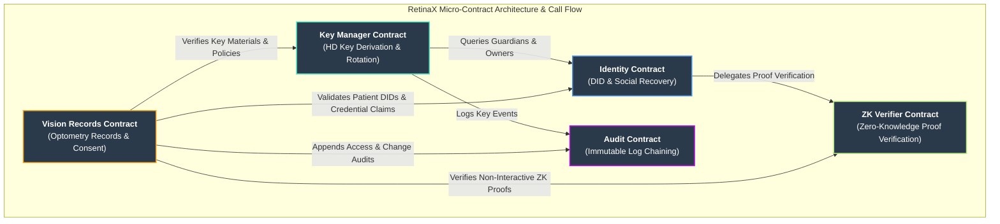

# RetinaX - Decentralized Vision Care Records on Stellar

[](https://www.rust-lang.org/)
[](https://soroban.stellar.org/)
[](LICENSE)
[](https://github.com/RetinaX-Org/RetinaX/actions)

RetinaX is a decentralized smart contract system for secure, encrypted, and role-based management of vision care and optometry records on the Stellar blockchain using Soroban and Rust. The project enables eye care providers and patients to maintain control over sensitive vision data while ensuring privacy, immutability, and auditability. Built specifically for optometry clinics, ophthalmology practices, and vision research institutions transitioning to blockchain-based record keeping.

The platform provides a comprehensive solution for modern vision care data management, combining the security benefits of blockchain technology with practical healthcare workflows. It's designed for optometrists, ophthalmologists, vision research institutions, and patients who need to maintain confidentiality while enabling secure data sharing between authorized parties.

---

## Table of Contents

- [Project Overview](#project-overview)
- [Setup Instructions](#setup-instructions)
  - [Prerequisites](#prerequisites)
  - [Quick Start](#quick-start)
  - [Environment Setup](#environment-setup)
  - [Running Tests](#running-tests)
  - [Network Configuration](#network-configuration)
- [Features](#features)
- [Micro-Contract Architecture](#micro-contract-architecture)
- [Project Structure](#project-structure)
- [Usage Examples](#usage-examples)
- [Deployment](#deployment)
- [CI/CD Pipeline](#cicd-pipeline)
- [Helpful Links](#helpful-links)
- [Contribution Guidelines](#contribution-guidelines)
- [License](#license)
- [Support](#support)

---

## Project Overview

RetinaX transforms vision care record management by leveraging Stellar's blockchain infrastructure to create an immutable, secure, and patient-centric eye care data ecosystem. The system addresses critical healthcare challenges including data breaches, interoperability issues, and patient privacy concerns through cryptographic security and decentralized governance.

### Key Benefits

| Benefit | Description |
|---------|-------------|
| **Enhanced Security** | Military-grade encryption protects sensitive vision data |
| **Patient Control** | Patients grant and revoke access to their records |
| **Interoperability** | Standardized format enables seamless data exchange |
| **Audit Trail** | Complete, immutable history of all record access and modifications |
| **Vision-Specific** | Tailored for optometry and ophthalmology workflows |

### Target Users

- Optometry clinics and ophthalmology practices
- Vision research institutions
- Eye care insurance providers
- Patients seeking control over their vision data
- Optical retail chains and laboratories

---

## Setup Instructions

### Prerequisites

Before you begin, ensure you have the following installed:

- **Rust 1.78.0+** - [Install Rust](https://www.rust-lang.org/tools/install)
- **Soroban CLI** - [Install Soroban](https://soroban.stellar.org/docs/getting-started/installation) (contracts target `soroban-sdk` 25.0.0)
- **Git** - For version control
- **Make** - For using the provided Makefile (optional but recommended)

### Quick Start

Get up and running in under 5 minutes:

```bash
# Clone the repository
git clone https://github.com/RetinaX-Org/RetinaX.git
cd RetinaX

# Run the automated setup script
chmod +x setup.sh
./setup.sh

# Or use the Makefile for step-by-step setup
make setup
```

### Environment Setup

#### Option 1: Automated Setup (Recommended)

The `setup.sh` script handles everything automatically:

```bash
./setup.sh
```

This script will:
- Install Rust (if missing), the `wasm32-unknown-unknown` target, and `rustfmt`/`clippy`/`rust-src`
- Install the Soroban CLI (if missing)
- Generate a `default` identity
- Configure Soroban networks (local, testnet, futurenet)
- Build the project and run tests

#### Option 2: Manual Setup

```bash
# Install Rust targets and components
rustup target add wasm32-unknown-unknown
rustup component add rustfmt clippy rust-src

# Install Soroban CLI
cargo install --locked soroban-cli

# Configure Soroban
soroban config identity generate default
soroban config network add local \
    --rpc-url http://localhost:8000/soroban/rpc \
    --network-passphrase "Standalone Network ; February 2017"

# Build the project
cargo build --all-targets

# Run tests to verify setup
cargo test --all
```

### Running Tests

Ensure everything is working correctly:

```bash
# Run all tests
make test

# Or use cargo directly
cargo test --all

# Run specific test types
make test-unit          # Unit tests only
make test-integration   # Integration tests only
```

### Network Configuration

The project supports multiple Stellar networks:

```bash
# Start local development network
make start-local
# or
soroban network start local

# Deploy to local network
make deploy-local

# Stop local network
make stop-local
```

**Available Networks:**

| Network | URL | Purpose |
|---------|-----|---------|
| Local | `http://localhost:8000/soroban/rpc` | Development |
| Testnet | `https://soroban-testnet.stellar.org:443` | Testing |
| Futurenet | `https://rpc-futurenet.stellar.org:443` | Staging |

---

## Features

- Encrypted on-chain vision care records storage
- Role-based access control (patients, optometrists, ophthalmologists, admins)
- Immutable timestamping and full history tracking
- Comprehensive eye exam and prescription data management
- Public key-based identity verification
- Fully testable, modular, and CI-enabled
- Gas-efficient contract design
- Decentralized governance with Governor + Timelock (proposals, voting, queued execution)
- Vision health analytics and trend tracking
- Multi-provider record sharing
- AI-powered vision analysis integration with provider verification and anomaly flagging

---

## Micro-Contract Architecture

The following diagram details the dependency graph and cross-contract call flow between the core micro-contracts (`audit`, `identity`, `key_manager`, `zk_verifier`, `vision_records`):



---

## Project Structure

```
RetinaX/
│
├── contracts/                  # Soroban smart contracts (Cargo workspace members)
│   ├── vision_records/         # Core optometry records, consent & prescriptions
│   ├── identity/               # DIDs and social recovery
│   ├── key_manager/            # HD key derivation & rotation
│   ├── zk_verifier/            # Zero-knowledge proof verification
│   ├── audit/                  # Immutable, chained audit log
│   ├── governor/ timelock/     # On-chain governance
│   ├── common/                 # Shared types and helpers
│   └── ...                     # analytics, compliance, fhir, staking, treasury, etc.
│
├── sdk/zk_prover/              # Off-chain ZK proof generation SDK
├── offchain-server/            # Off-chain node: audit-log REST API (see its README)
├── test/                       # Shared test framework, negative & upgrade tests
├── tests/integration/          # Cross-contract integration tests
├── fuzz/                       # Fuzzing targets
├── scripts/                    # Deployment, release & monitoring scripts
│   └── monitor/                # Prometheus/Grafana stack and health check
├── website/                    # Project website (GitHub Pages)
├── docs/                       # Architecture, API, onboarding, runbooks, compliance
│
├── .github/workflows/          # CI workflows
├── setup.sh                    # Automated setup script
├── Makefile                    # Build automation (`make help` lists targets)
├── Cargo.toml                  # Workspace configuration
└── README.md                   # This file
```

---

## Usage Examples

### Basic Contract Interaction

Interacting with the `vision_records` contract from a Soroban test:

```rust
// Initialize the contract with an admin
client.initialize(&admin);

// Register a patient and an optometrist
client.register_user(&admin, &patient, &Role::Patient, &String::from_str(&env, "Jane Doe"));
client.register_user(&admin, &optometrist, &Role::Optometrist, &String::from_str(&env, "Dr. Smith"));

// Add an exam record (the data hash points to encrypted off-chain data)
let record_id = client.add_record(
    &optometrist,
    &patient,
    &optometrist,
    &RecordType::Examination,
    &String::from_str(&env, "QmHash..."),
);

// Patient grants an optometrist read access for 30 days
client.grant_access(&patient, &patient, &optometrist, &AccessLevel::Read, &(30 * 24 * 60 * 60));

// Retrieve a patient's record IDs and a single record
let record_ids = client.get_patient_records(&patient);
let record = client.get_record(&optometrist, &record_id);
```

### Using the Makefile

```bash
# Build all contracts
make build

# Run all tests
make test

# Deploy to testnet
make deploy-testnet

# Generate documentation
make docs
```

---

## Deployment

### Local Development

```bash
make deploy-local
```

### Testnet Deployment

```bash
# Configure testnet identity
soroban config identity generate deployer

# Fund the account (use Stellar Laboratory)
# Deploy contracts
make deploy-testnet
```

### Production Deployment

```bash
# Ensure all tests pass
make test

# Build optimized contracts
make build-release

# Deploy to mainnet (requires proper key management)
make deploy-mainnet
```

---

## CI/CD Pipeline

### GitHub Actions Workflows

| Workflow | Trigger | Purpose |
|----------|---------|---------|
| `cargo-test.yml` | Push/PR to `main` | Build and test the Cargo workspace |
| `rust-fmt.yml` | Push/PR touching Rust code | `cargo fmt` check |
| `identity-ci.yml` | Push/PR touching `identity` | Identity contract build, lint & tests |
| `key-manager-ci.yml` | Push/PR touching `key_manager` | Key Manager contract build, lint & tests |
| `zk-verifier-ci.yml` | Push/PR touching `zk_verifier` | ZK Verifier contract build, lint & tests |
| `frontend-lint.yml` | Push/PR touching `website/` | ESLint/Prettier checks for the website |
| `pages.yml` | Push to `main` | Deploy the website to GitHub Pages |

### Deployment Scripts

```bash
# Deploy with rollback support
./scripts/deploy_with_rollback.sh testnet

# Run a contract / RPC health check
./scripts/monitor/health_check.sh
```

---

## Helpful Links

### Documentation

- [API Reference](docs/api.md)
- [Architecture Overview](docs/architecture.md)
- [Data Flow Diagrams](docs/data-flows.md)
- [Security Model](docs/security.md)
- [Production Runbook](docs/runbook/README.md)
- [Compliance Documentation](docs/compliance/README.md) - HIPAA compliance and regulatory requirements

### Repository Resources

- [Contributing Guide](CONTRIBUTING.md)
- [Contributor Onboarding](docs/onboarding/README.md)
- [Code of Conduct](CODE_OF_CONDUCT.md)
- [Changelog](CHANGELOG.md)

### External Resources

- [Stellar Developer Docs](https://developers.stellar.org/)
- [Soroban Documentation](https://soroban.stellar.org/docs)
- [Rust Documentation](https://doc.rust-lang.org/)

---

## Contribution Guidelines

We welcome contributions! Please follow these guidelines:

Start with the [Contributor Onboarding](docs/onboarding/README.md) guide for a full setup and first-PR walkthrough.

### Getting Started

1. **Fork** the repository
2. **Clone** your fork locally
3. **Create** a feature branch: `git checkout -b feature/your-feature`
4. **Make** your changes
5. **Test** your changes: `cargo test --all`
6. **Commit** with a descriptive message
7. **Push** to your fork
8. **Submit** a Pull Request

### Development Workflow

```bash
# Create a feature branch
git checkout -b feature/issue-number-description

# Make changes and test
cargo fmt
cargo clippy
cargo test --all

# Commit changes
git commit -m "feat: description of changes (closes #issue-number)"

# Push and create PR
git push origin feature/issue-number-description
```

### Code Standards

- Follow Rust style guidelines (`cargo fmt`)
- Pass all Clippy lints (`cargo clippy`)
- Write tests for new functionality
- Update documentation as needed
- Use conventional commit messages

### Review Process

1. All PRs require at least one approval
2. CI must pass before merging
3. Maintain test coverage above 80%
4. Address all review comments

### Definition of Done

- [ ] Code compiles without warnings
- [ ] All tests pass
- [ ] Documentation updated
- [ ] PR description is complete
- [ ] Linked to relevant issue

---

## License

This project is licensed under the MIT License - see the [LICENSE](LICENSE) file for details.

---

## Support

- **Issues**: [GitHub Issues](https://github.com/RetinaX-Org/RetinaX/issues)
- **Discussions**: [GitHub Discussions](https://github.com/RetinaX-Org/RetinaX/discussions)
- **Discord**: [Join our Discord](https://discord.gg/stellar-retinax)

---

<p align="center">
  Built with ❤️ on Stellar
</p>
