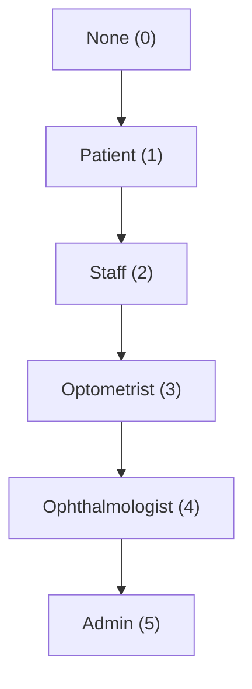
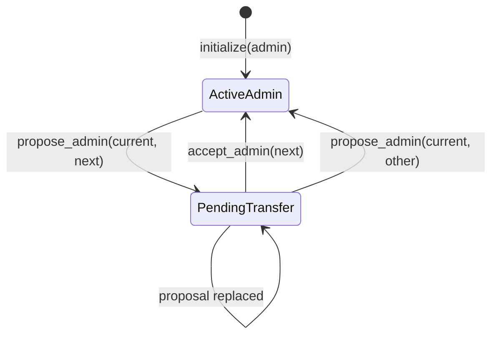
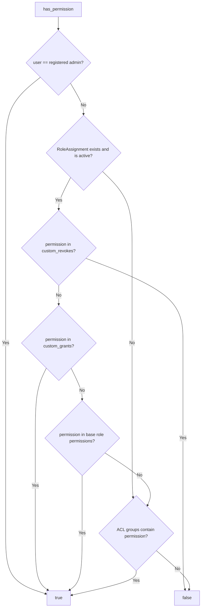
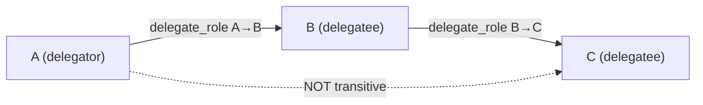
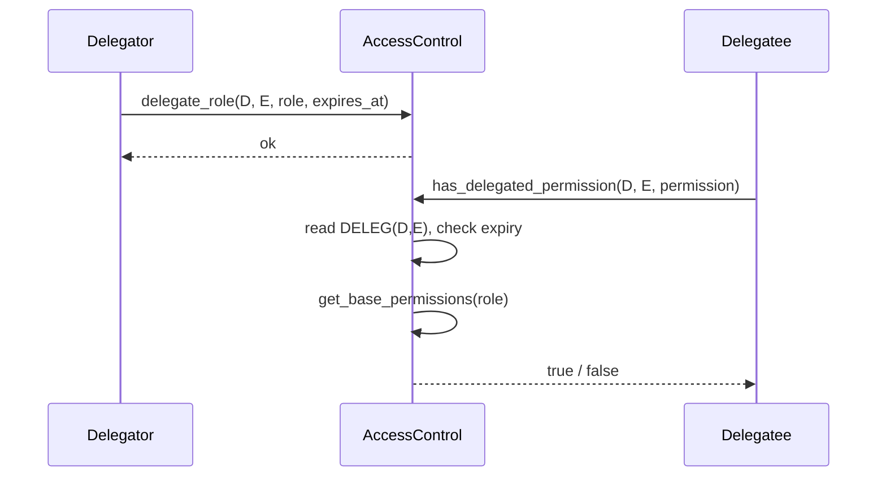
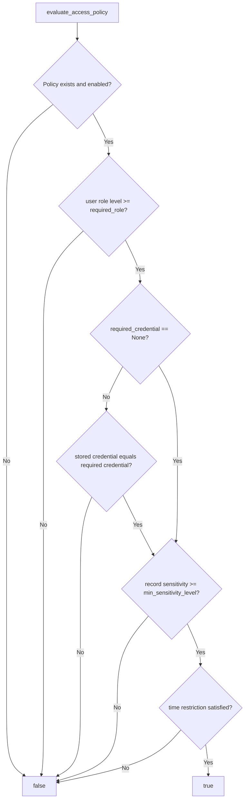

# Access Control Contract API Reference

> **Source:** `contracts/access_control/src/`
> **Modules:** `lib.rs`, `admin.rs`, `permissions.rs`, `types.rs`, `whitelist.rs`
> **Contract type:** Soroban micro-contract (`AccessControlContract`)
> **Version:** workspace `1.2.2`

## Overview

`access_control` is the authorization micro-contract for RetinaX. It combines:

- **Role-Based Access Control (RBAC)** — five roles with base permission sets and time-bound assignments.
- **Attribute-Based Access Control (ABAC)** — policies evaluated against role, credential, record sensitivity, and time.
- **Delegation** — full-role or permission-scoped delegation from one address to another.
- **ACL groups** — named permission bundles that users can join.
- **Admin whitelist** — optional address allow-list with an admin-controlled enable flag.
- **Two-step admin transfer** — nominate then accept a new administrator.

The contract stores authorization state in two Soroban storage tiers:

| Tier | Used for |
| --- | --- |
| **Instance** | Administrator, pending administrator, whitelist enable flag |
| **Persistent** | Role assignments, delegations, ACL groups, policies, credentials, record sensitivity, whitelist entries |

### Module map

| Module | Responsibility |
| --- | --- |
| `admin.rs` | Initialization, admin lookup, two-step admin transfer, `require_admin` |
| `whitelist.rs` | Enable/disable whitelist, add/remove members, membership checks |
| `permissions.rs` | RBAC, custom grants/revokes, delegations, ACL groups, ABAC evaluation |
| `types.rs` | Public enums, structs, error codes, base-permission mapping |
| `lib.rs` | On-chain entry points exposed by `AccessControlContract` |

---

## Public API Summary

All `env` parameters are supplied by the Soroban runtime and are omitted from client-side calls.

| Function | Domain | Caller authentication | Returns |
| --- | --- | --- | --- |
| [`initialize`](#initialize) | Admin | `admin.require_auth()` | `Result<(), AccessControlError>` |
| [`get_admin`](#get_admin) | Admin | None | `Option<Address>` |
| [`propose_admin`](#propose_admin) | Admin | Current admin | `Result<(), AccessControlError>` |
| [`accept_admin`](#accept_admin) | Admin | Pending admin | `Result<(), AccessControlError>` |
| [`set_whitelist_enabled`](#set_whitelist_enabled) | Whitelist | Admin | `Result<(), AccessControlError>` |
| [`is_whitelist_enabled`](#is_whitelist_enabled) | Whitelist | None | `bool` |
| [`add_to_whitelist`](#add_to_whitelist) | Whitelist | Admin | `Result<(), AccessControlError>` |
| [`remove_from_whitelist`](#remove_from_whitelist) | Whitelist | Admin | `Result<(), AccessControlError>` |
| [`check_whitelist`](#check_whitelist) | Whitelist | None | `bool` |
| [`is_whitelisted`](#is_whitelisted) | Whitelist | None | `bool` |
| [`assign_role`](#assign_role) | RBAC | `ManageUsers` | `Result<(), AccessControlError>` |
| [`revoke_role`](#revoke_role) | RBAC | `ManageUsers` | `Result<(), AccessControlError>` |
| [`get_role`](#get_role) | RBAC | None | `Role` |
| [`has_permission`](#has_permission) | RBAC | None | `bool` |
| [`grant_custom_permission`](#grant_custom_permission) | RBAC | `ManageUsers` | `Result<(), AccessControlError>` |
| [`revoke_custom_permission`](#revoke_custom_permission) | RBAC | `ManageUsers` | `Result<(), AccessControlError>` |
| [`delegate_role`](#delegate_role) | Delegation | Delegator | `Result<(), AccessControlError>` |
| [`revoke_delegation`](#revoke_delegation) | Delegation | Delegator | `Result<(), AccessControlError>` |
| [`has_delegated_permission`](#has_delegated_permission) | Delegation | None | `bool` |
| [`delegate_permissions`](#delegate_permissions) | Delegation | Delegator | `Result<(), AccessControlError>` |
| [`revoke_scoped_delegation`](#revoke_scoped_delegation) | Delegation | Delegator | `Result<(), AccessControlError>` |
| [`create_group`](#create_group) | ACL | `ManageAccess` | `Result<(), AccessControlError>` |
| [`add_to_group`](#add_to_group) | ACL | `ManageAccess` | `Result<(), AccessControlError>` |
| [`remove_from_group`](#remove_from_group) | ACL | `ManageAccess` | `Result<(), AccessControlError>` |
| [`get_user_groups`](#get_user_groups) | ACL | None | `Vec<Symbol>` |
| [`create_access_policy`](#create_access_policy) | ABAC | `SystemAdmin` | `Result<(), AccessControlError>` |
| [`set_user_credential`](#set_user_credential) | ABAC | `ManageUsers` | `Result<(), AccessControlError>` |
| [`set_record_sensitivity`](#set_record_sensitivity) | ABAC | `WriteRecord` | `Result<(), AccessControlError>` |
| [`evaluate_access_policy`](#evaluate_access_policy) | ABAC | None | `bool` |

> `admin::get_pending_admin` and `types::get_base_permissions` are public library helpers but are not exposed as contract entry points. They are documented in the [library helpers](#library-helpers) appendix.

---

## Data Types

### `Role`

Defined in `types.rs`. Values form the trust ranking used by ABAC (`role as u32`).

| Variant | Level | Description |
| --- | ---: | --- |
| `None` | 0 | No role assigned. |
| `Patient` | 1 | Record owner; consent is managed outside this contract. |
| `Staff` | 2 | Clinical/administrative support. |
| `Optometrist` | 3 | Eye-care specialist. |
| `Ophthalmologist` | 4 | Senior surgical/diagnostic specialist. |
| `Admin` | 5 | Full administrative rights. |

### `Permission`

| Variant | ID | Capability |
| --- | ---: | --- |
| `ReadAnyRecord` | 1 | Read any patient record. |
| `WriteRecord` | 2 | Create or update clinical/vision records. |
| `ManageAccess` | 3 | Grant, revoke, or modify record access and ACL groups. |
| `ManageUsers` | 4 | Assign roles, credentials, and custom permissions. |
| `SystemAdmin` | 5 | System-level configuration and ABAC policy creation. |

### `RoleAssignment`

Stored at `("ROLE_ASN", user)`.

| Field | Type | Description |
| --- | --- | --- |
| `role` | `Role` | Base role for the user. |
| `custom_grants` | `Vec<Permission>` | Permissions explicitly granted beyond the role. |
| `custom_revokes` | `Vec<Permission>` | Permissions explicitly denied; checked before grants. |
| `expires_at` | `u64` | Unix timestamp in seconds. `0` means permanent. |

### `Delegation`

Stored at `("DELEG", delegator, delegatee)`.

| Field | Type | Description |
| --- | --- | --- |
| `delegator` | `Address` | Address granting the delegation. |
| `delegatee` | `Address` | Address receiving the delegation. |
| `role` | `Role` | Role whose base permissions are delegated. |
| `expires_at` | `u64` | Expiry timestamp in seconds; `0` means permanent. |

### `ScopedDelegation`

Stored at `("SC_DEL", delegator, delegatee)`.

| Field | Type | Description |
| --- | --- | --- |
| `delegator` | `Address` | Address granting the delegation. |
| `delegatee` | `Address` | Address receiving the delegation. |
| `permissions` | `Vec<Permission>` | Explicit permissions delegated. |
| `expires_at` | `u64` | Expiry timestamp in seconds; `0` means permanent. |

### `AclGroup`

Stored at `("ACL_GRP", group_name)`.

| Field | Type | Description |
| --- | --- | --- |
| `name` | `Symbol` | Group identifier. |
| `permissions` | `Vec<Permission>` | Permissions granted to all members. |

### `PolicyConditions`

Part of an `AccessPolicy`; every populated condition must pass for the policy to allow access.

| Field | Type | Description |
| --- | --- | --- |
| `required_role` | `Role` | Minimum role level required (`user_role >= required_role`). |
| `time_restriction` | `TimeRestriction` | Time window restriction. |
| `required_credential` | `CredentialType` | Exact credential required; `None` disables the check. |
| `min_sensitivity_level` | `SensitivityLevel` | Minimum record sensitivity required. |
| `consent_required` | `bool` | Reserved flag; current evaluation does not inspect consent. |

### `AccessPolicy`

Stored at `("ACC_POL", policy_id)`.

| Field | Type | Description |
| --- | --- | --- |
| `id` | `Symbol` | Policy identifier. |
| `name` | `Symbol` | Human-readable policy name. |
| `conditions` | `PolicyConditions` | Conditions evaluated by `evaluate_access_policy`. |
| `enabled` | `bool` | Disabled policies always deny. `create_access_policy` sets this to `true`. |

### `TimeRestriction`

| Variant | Behavior |
| --- | --- |
| `None` | No time check. |
| `BusinessHours` | Allows `09:00`–`16:59` UTC (`9..17`). |
| `HourRange(start, end)` | Allows hours `start..=end` inclusive. |
| `DaysOfWeek(mask)` | Bitmask of allowed weekdays. Bit 0 = Sunday; the contract computes `(timestamp / 86400 + 4) % 7`. |

### `CredentialType`

| Variant | Meaning |
| --- | --- |
| `None` | No credential requirement. |
| `MedicalLicense` | Verified medical license. |
| `ResearchCredentials` | Research authorization. |
| `EmergencyCredentials` | Emergency override credential. |
| `AdminCredentials` | Administrative credential. |

### `SensitivityLevel`

| Variant | Level | Meaning |
| --- | ---: | --- |
| `Public` | 0 | Public data. |
| `Standard` | 1 | Default for records without an explicit sensitivity. |
| `Confidential` | 2 | Sensitive clinical data. |
| `Restricted` | 3 | Highly sensitive data. |

### `AccessControlError`

| Code | Variant | Meaning |
| ---: | --- | --- |
| 1 | `Unauthorized` | Caller failed an auth or permission check. |
| 2 | `InvalidInput` | Invalid identifier or parameter. |
| 3 | `NotFound` | Expected assignment, policy, or pending admin was absent. |
| 4 | `DelegationExpired` | Delegation is expired or invalid. |
| 5 | `Paused` | Contract paused (defined for compatibility; no pause entry point exists). |
| 6 | `AlreadyExists` | Duplicate entity. |
| 7 | `AlreadyInitialized` | `initialize` was called more than once. |

`MAX_STRING_LEN = 64` bounds string identifiers used by RBAC storage.

---

## Role Hierarchy



The numeric level is used for the `required_role` comparison in ABAC. RBAC base permissions are defined separately by `get_base_permissions` and do not strictly increase at every level: `Optometrist` and `Ophthalmologist` currently receive the same base set, while `Staff` receives only `ManageUsers`.

---

## Permission Matrix

### Base permissions by role

`✅` = granted by `get_base_permissions(role)`. This matrix reflects the implementation, not an aspirational policy.

| Permission | Patient | Staff | Optometrist | Ophthalmologist | Admin |
| --- | :---: | :---: | :---: | :---: | :---: |
| `ReadAnyRecord` | ❌ | ❌ | ✅ | ✅ | ✅ |
| `WriteRecord` | ❌ | ❌ | ✅ | ✅ | ✅ |
| `ManageAccess` | ❌ | ❌ | ✅ | ✅ | ✅ |
| `ManageUsers` | ❌ | ✅ | ✅ | ✅ | ✅ |
| `SystemAdmin` | ❌ | ❌ | ❌ | ❌ | ✅ |

`Role::None` receives no permissions. A user with no `RoleAssignment` also receives no base permissions, but may still receive permissions through ACL groups or a custom grant (custom grants require an existing assignment).

### Permission sources and evaluation

| Source | Stored in | Checked by `has_permission` | Precedence |
| --- | --- | --- | --- |
| Registered admin | Instance `ADMIN` | Yes — unconditional allow | 0 (highest) |
| Custom revoke | `RoleAssignment.custom_revokes` | Yes — unconditional deny | 1 |
| Custom grant | `RoleAssignment.custom_grants` | Yes — allow | 2 |
| Base role | `RoleAssignment.role` | Yes — allow | 3 |
| ACL groups | `USR_GRPS` + `ACL_GRP` | Yes — allow | 4 |
| Full/scoped delegation | `DELEG` / `SC_DEL` | Only through `has_delegated_permission` | Separate call |
| Default | — | Deny | 5 (lowest) |

> A delegation does **not** make `has_permission(user, permission)` return `true`. Callers must explicitly invoke `has_delegated_permission(delegator, delegatee, permission)` and combine the result with their own authorization policy.

---

## Admin Functions

### `initialize`

```rust
pub fn initialize(env: Env, admin: Address) -> Result<(), AccessControlError>
```

Initializes the contract with the first administrator. The admin must authorize the call.

**Parameters**

| Name | Type | Description |
| --- | --- | --- |
| `admin` | `Address` | Initial administrator; also receives an implicit `Admin` role. |

**Returns:** `Result<(), AccessControlError>`

**Errors:** `AlreadyInitialized` if `ADMIN` already exists in instance storage.

**Storage:** writes `ADMIN` (instance).

---

### `get_admin`

```rust
pub fn get_admin(env: Env) -> Option<Address>
```

Returns the active administrator, or `None` before initialization.

**Parameters:** none.

**Returns:** `Option<Address>`

---

### `propose_admin`

```rust
pub fn propose_admin(
    env: Env,
    current_admin: Address,
    new_admin: Address,
) -> Result<(), AccessControlError>
```

Starts a two-step admin transfer by storing a pending administrator.

**Parameters**

| Name | Type | Description |
| --- | --- | --- |
| `current_admin` | `Address` | Must authenticate and match the stored admin. |
| `new_admin` | `Address` | Address proposed as the next administrator. |

**Returns:** `Result<(), AccessControlError>`

**Errors:** `Unauthorized` if `current_admin` is not the active admin.

**Storage:** writes `PEND_ADM` (instance).

---

### `accept_admin`

```rust
pub fn accept_admin(env: Env, new_admin: Address) -> Result<(), AccessControlError>
```

Completes the transfer. The nominee must authorize and match `PEND_ADM`.

**Parameters**

| Name | Type | Description |
| --- | --- | --- |
| `new_admin` | `Address` | Nominee accepting the role. |

**Returns:** `Result<(), AccessControlError>`

**Errors:**

- `NotFound` — no pending administrator.
- `Unauthorized` — `new_admin` does not match the nominee.

**Storage:** writes `ADMIN`, removes `PEND_ADM` (instance).



---

## Whitelist Functions

### `set_whitelist_enabled`

```rust
pub fn set_whitelist_enabled(
    env: Env,
    caller: Address,
    enabled: bool,
) -> Result<(), AccessControlError>
```

Enables or disables whitelist enforcement.

**Parameters**

| Name | Type | Description |
| --- | --- | --- |
| `caller` | `Address` | Must authenticate and be the active admin. |
| `enabled` | `bool` | `true` to enforce the whitelist. |

**Returns:** `Result<(), AccessControlError>`

**Errors:** `Unauthorized` if `caller` is not the admin.

**Storage:** writes `WL_EN` (instance).

---

### `is_whitelist_enabled`

```rust
pub fn is_whitelist_enabled(env: Env) -> bool
```

Returns the enforcement flag. Defaults to `false` when unset.

---

### `add_to_whitelist`

```rust
pub fn add_to_whitelist(
    env: Env,
    caller: Address,
    user: Address,
) -> Result<(), AccessControlError>
```

Adds an address to the whitelist. Admin only.

**Parameters**

| Name | Type | Description |
| --- | --- | --- |
| `caller` | `Address` | Must authenticate and be the active admin. |
| `user` | `Address` | Address to allow-list. |

**Returns:** `Result<(), AccessControlError>`

**Errors:** `Unauthorized` if `caller` is not the admin.

**Storage:** writes `("WL", user) = true` (persistent).

---

### `remove_from_whitelist`

```rust
pub fn remove_from_whitelist(
    env: Env,
    caller: Address,
    user: Address,
) -> Result<(), AccessControlError>
```

Removes an address from the whitelist. Admin only.

**Parameters**

| Name | Type | Description |
| --- | --- | --- |
| `caller` | `Address` | Must authenticate and be the active admin. |
| `user` | `Address` | Address to remove. |

**Returns:** `Result<(), AccessControlError>`

**Errors:** `Unauthorized` if `caller` is not the admin.

**Storage:** removes `("WL", user)` (persistent).

---

### `check_whitelist`

```rust
pub fn check_whitelist(env: Env, user: Address) -> bool
```

Returns `true` when enforcement is disabled. When enabled, returns the raw whitelist membership value.

**Parameters**

| Name | Type | Description |
| --- | --- | --- |
| `user` | `Address` | Address to check. |

**Returns:** `bool`

> **Enforcement note:** no other entry point in this contract calls `check_whitelist`. The flag and helper are available to integrating contracts, but role assignment, permissions, and ABAC evaluation are not automatically gated by whitelist membership in this version.

---

### `is_whitelisted`

```rust
pub fn is_whitelisted(env: Env, user: Address) -> bool
```

Returns raw membership without considering `is_whitelist_enabled`.

**Parameters**

| Name | Type | Description |
| --- | --- | --- |
| `user` | `Address` | Address to check. |

**Returns:** `bool` — `false` if no entry exists.

---

## RBAC Functions

### `assign_role`

```rust
pub fn assign_role(
    env: Env,
    caller: Address,
    user: Address,
    role: Role,
    expires_at: u64,
) -> Result<(), AccessControlError>
```

Assigns a role and resets the user's custom grant/revoke lists.

**Parameters**

| Name | Type | Description |
| --- | --- | --- |
| `caller` | `Address` | Must authenticate and hold `ManageUsers`. |
| `user` | `Address` | User receiving the role. |
| `role` | `Role` | Role to assign. |
| `expires_at` | `u64` | Expiry timestamp in seconds; `0` = permanent. |

**Returns:** `Result<(), AccessControlError>`

**Errors:** `Unauthorized` if the caller lacks `ManageUsers`.

**Storage:** writes `("ROLE_ASN", user)` with empty `custom_grants` and `custom_revokes`.

> Re-assigning a role overwrites existing custom grants and revokes for that user.

---

### `revoke_role`

```rust
pub fn revoke_role(
    env: Env,
    caller: Address,
    user: Address,
) -> Result<(), AccessControlError>
```

Removes the user's role assignment entirely.

**Parameters**

| Name | Type | Description |
| --- | --- | --- |
| `caller` | `Address` | Must authenticate and hold `ManageUsers`. |
| `user` | `Address` | User whose assignment is removed. |

**Returns:** `Result<(), AccessControlError>`

**Errors:** `Unauthorized` if the caller lacks `ManageUsers`.

**Storage:** removes `("ROLE_ASN", user)`.

---

### `get_role`

```rust
pub fn get_role(env: Env, user: Address) -> Role
```

Returns the active role. The registered admin is always `Role::Admin`, even without a stored assignment. Expired assignments return `Role::None`.

**Parameters**

| Name | Type | Description |
| --- | --- | --- |
| `user` | `Address` | Address to inspect. |

**Returns:** `Role`

---

### `has_permission`

```rust
pub fn has_permission(env: Env, user: Address, permission: Permission) -> bool
```

Evaluates RBAC permission sources in priority order.

**Parameters**

| Name | Type | Description |
| --- | --- | --- |
| `user` | `Address` | Address being checked. |
| `permission` | `Permission` | Permission to test. |

**Returns:** `bool`

**Evaluation order**



---

### `grant_custom_permission`

```rust
pub fn grant_custom_permission(
    env: Env,
    caller: Address,
    user: Address,
    permission: Permission,
) -> Result<(), AccessControlError>
```

Appends a custom grant to an existing `RoleAssignment`.

**Parameters**

| Name | Type | Description |
| --- | --- | --- |
| `caller` | `Address` | Must authenticate and hold `ManageUsers`. |
| `user` | `Address` | User receiving the grant. |
| `permission` | `Permission` | Permission to grant. |

**Returns:** `Result<(), AccessControlError>`

**Errors:**

- `Unauthorized` — caller lacks `ManageUsers`.
- `NotFound` — user has no `RoleAssignment`.

**Storage:** updates `("ROLE_ASN", user).custom_grants`.

---

### `revoke_custom_permission`

```rust
pub fn revoke_custom_permission(
    env: Env,
    caller: Address,
    user: Address,
    permission: Permission,
) -> Result<(), AccessControlError>
```

Appends an explicit deny to an existing `RoleAssignment`. Explicit denies take precedence over grants, role permissions, and ACL groups.

**Parameters**

| Name | Type | Description |
| --- | --- | --- |
| `caller` | `Address` | Must authenticate and hold `ManageUsers`. |
| `user` | `Address` | User receiving the explicit deny. |
| `permission` | `Permission` | Permission to deny. |

**Returns:** `Result<(), AccessControlError>`

**Errors:** `Unauthorized`, `NotFound` (no assignment).

**Storage:** updates `("ROLE_ASN", user).custom_revokes`.

---

## Delegation

Delegations are direct, pairwise grants. They are evaluated by `has_delegated_permission`, not by `has_permission`.

### `delegate_role`

```rust
pub fn delegate_role(
    env: Env,
    delegator: Address,
    delegatee: Address,
    role: Role,
    expires_at: u64,
) -> Result<(), AccessControlError>
```

Delegates the base permissions of a role to another address.

**Parameters**

| Name | Type | Description |
| --- | --- | --- |
| `delegator` | `Address` | Must authorize. |
| `delegatee` | `Address` | Recipient of the role permissions. |
| `role` | `Role` | Role whose base permissions are delegated. |
| `expires_at` | `u64` | Expiry timestamp in seconds; `0` = permanent. |

**Returns:** `Result<(), AccessControlError>`

**Storage:** writes `("DELEG", delegator, delegatee)`.

---

### `revoke_delegation`

```rust
pub fn revoke_delegation(
    env: Env,
    delegator: Address,
    delegatee: Address,
) -> Result<(), AccessControlError>
```

Deletes a full-role delegation. The delegator must authorize.

**Parameters**

| Name | Type | Description |
| --- | --- | --- |
| `delegator` | `Address` | Must authorize. |
| `delegatee` | `Address` | Delegation recipient. |

**Returns:** `Result<(), AccessControlError>`

**Storage:** removes `("DELEG", delegator, delegatee)`.

---

### `has_delegated_permission`

```rust
pub fn has_delegated_permission(
    env: Env,
    delegator: Address,
    delegatee: Address,
    permission: Permission,
) -> bool
```

Returns `true` if a full-role or scoped delegation from `delegator` to `delegatee` is active and includes `permission`.

**Parameters**

| Name | Type | Description |
| --- | --- | --- |
| `delegator` | `Address` | Original grantor. |
| `delegatee` | `Address` | Address being checked. |
| `permission` | `Permission` | Permission to test. |

**Returns:** `bool`

**Evaluation order:**

1. Full-role delegation at `("DELEG", delegator, delegatee)`; if active, test the role's base permissions.
2. Scoped delegation at `("SC_DEL", delegator, delegatee)`; if active, test the explicit permission list.
3. Otherwise deny.

---

### `delegate_permissions`

```rust
pub fn delegate_permissions(
    env: Env,
    delegator: Address,
    delegatee: Address,
    permissions: Vec<Permission>,
    expires_at: u64,
) -> Result<(), AccessControlError>
```

Delegates a specific set of permissions.

**Parameters**

| Name | Type | Description |
| --- | --- | --- |
| `delegator` | `Address` | Must authorize. |
| `delegatee` | `Address` | Recipient. |
| `permissions` | `Vec<Permission>` | Permissions delegated. |
| `expires_at` | `u64` | Expiry timestamp in seconds; `0` = permanent. |

**Returns:** `Result<(), AccessControlError>`

**Storage:** writes `("SC_DEL", delegator, delegatee)`.

---

### `revoke_scoped_delegation`

```rust
pub fn revoke_scoped_delegation(
    env: Env,
    delegator: Address,
    delegatee: Address,
) -> Result<(), AccessControlError>
```

Deletes a scoped delegation. The delegator must authorize.

**Parameters**

| Name | Type | Description |
| --- | --- | --- |
| `delegator` | `Address` | Must authorize. |
| `delegatee` | `Address` | Delegation recipient. |

**Returns:** `Result<(), AccessControlError>`

**Storage:** removes `("SC_DEL", delegator, delegatee)`.

### Delegation chain semantics



- `has_delegated_permission(A, C, permission)` is `false` unless A created a separate delegation directly to C.
- There is no chain traversal, inherited revocation, or automatic cleanup index.
- Revoking an upstream delegation does not delete downstream delegations created by the delegatee.
- A delegation may name any `Role`, including `Admin`, because the current implementation performs authentication only, not a permission check, when creating it.
- Expiry is checked at read time. No storage TTL extension is performed by this contract.



---

## ACL Group Functions

### `create_group`

```rust
pub fn create_group(
    env: Env,
    caller: Address,
    group_name: Symbol,
    permissions: Vec<Permission>,
) -> Result<(), AccessControlError>
```

Creates or replaces an ACL group.

**Parameters**

| Name | Type | Description |
| --- | --- | --- |
| `caller` | `Address` | Must authenticate and hold `ManageAccess`. |
| `group_name` | `Symbol` | Group identifier. |
| `permissions` | `Vec<Permission>` | Permissions granted to members. |

**Returns:** `Result<(), AccessControlError>`

**Errors:** `Unauthorized` if the caller lacks `ManageAccess`.

**Storage:** writes `("ACL_GRP", group_name)`.

---

### `add_to_group`

```rust
pub fn add_to_group(
    env: Env,
    caller: Address,
    user: Address,
    group_name: Symbol,
) -> Result<(), AccessControlError>
```

Adds a user to a group. Duplicate membership is ignored and returns `Ok(())`.

**Parameters**

| Name | Type | Description |
| --- | --- | --- |
| `caller` | `Address` | Must authenticate and hold `ManageAccess`. |
| `user` | `Address` | User joining the group. |
| `group_name` | `Symbol` | Existing group identifier. |

**Returns:** `Result<(), AccessControlError>`

**Errors:** `Unauthorized` if the caller lacks `ManageAccess`.

**Storage:** updates `("USR_GRPS", user)`.

> The function does not verify that the group exists. Membership in a non-existent group grants nothing until the group is created.

---

### `remove_from_group`

```rust
pub fn remove_from_group(
    env: Env,
    caller: Address,
    user: Address,
    group_name: Symbol,
) -> Result<(), AccessControlError>
```

Removes a user from a group. Removing a non-member is a no-op.

**Parameters**

| Name | Type | Description |
| --- | --- | --- |
| `caller` | `Address` | Must authenticate and hold `ManageAccess`. |
| `user` | `Address` | User leaving the group. |
| `group_name` | `Symbol` | Group identifier. |

**Returns:** `Result<(), AccessControlError>`

**Errors:** `Unauthorized` if the caller lacks `ManageAccess`.

**Storage:** rewrites `("USR_GRPS", user)` without the group.

---

### `get_user_groups`

```rust
pub fn get_user_groups(env: Env, user: Address) -> Vec<Symbol>
```

Returns all groups the user belongs to, or an empty vector.

**Parameters**

| Name | Type | Description |
| --- | --- | --- |
| `user` | `Address` | Address to inspect. |

**Returns:** `Vec<Symbol>`

---

## ABAC Functions

### `create_access_policy`

```rust
pub fn create_access_policy(
    env: Env,
    caller: Address,
    policy_id: Symbol,
    name: Symbol,
    conditions: PolicyConditions,
) -> Result<(), AccessControlError>
```

Creates or replaces an enabled ABAC policy.

**Parameters**

| Name | Type | Description |
| --- | --- | --- |
| `caller` | `Address` | Must authenticate and hold `SystemAdmin`. |
| `policy_id` | `Symbol` | Policy key. |
| `name` | `Symbol` | Display name. |
| `conditions` | `PolicyConditions` | Conditions to evaluate. |

**Returns:** `Result<(), AccessControlError>`

**Errors:** `Unauthorized` if the caller lacks `SystemAdmin`.

**Storage:** writes `("ACC_POL", policy_id)` with `enabled = true`.

---

### `set_user_credential`

```rust
pub fn set_user_credential(
    env: Env,
    caller: Address,
    user: Address,
    credential: CredentialType,
) -> Result<(), AccessControlError>
```

Sets a user's professional credential.

**Parameters**

| Name | Type | Description |
| --- | --- | --- |
| `caller` | `Address` | Must authenticate and hold `ManageUsers`. |
| `user` | `Address` | User receiving the credential. |
| `credential` | `CredentialType` | Credential value. |

**Returns:** `Result<(), AccessControlError>`

**Errors:** `Unauthorized` if the caller lacks `ManageUsers`.

**Storage:** writes `("USR_CRED", user)`.

---

### `set_record_sensitivity`

```rust
pub fn set_record_sensitivity(
    env: Env,
    caller: Address,
    record_id: u64,
    sensitivity: SensitivityLevel,
) -> Result<(), AccessControlError>
```

Classifies a record's sensitivity for ABAC comparisons.

**Parameters**

| Name | Type | Description |
| --- | --- | --- |
| `caller` | `Address` | Must authenticate and hold `WriteRecord`. |
| `record_id` | `u64` | Clinical/vision record identifier. |
| `sensitivity` | `SensitivityLevel` | Classification value. |

**Returns:** `Result<(), AccessControlError>`

**Errors:** `Unauthorized` if the caller lacks `WriteRecord`.

**Storage:** writes `("REC_SENS", record_id)`.

---

### `evaluate_access_policy`

```rust
pub fn evaluate_access_policy(
    env: Env,
    policy_id: Symbol,
    user: Address,
    record_id: u64,
    current_time: u64,
) -> bool
```

Evaluates a single policy against the current on-chain attributes. All populated conditions must pass.

**Parameters**

| Name | Type | Description |
| --- | --- | --- |
| `policy_id` | `Symbol` | Policy to evaluate. |
| `user` | `Address` | Requesting user. |
| `record_id` | `u64` | Record being accessed (used for sensitivity). |
| `current_time` | `u64` | Unix timestamp in seconds used for time restrictions. |

**Returns:** `bool` — `true` only when the policy exists, is enabled, and every condition passes.

**Evaluation flow**



**Condition details**

| Condition | Default when unset | Rule |
| --- | --- | --- |
| Role | `Role::None` | `get_role(user) as u32 >= required_role as u32` |
| Credential | `CredentialType::None` | If policy requires a credential, stored credential must match exactly |
| Sensitivity | `SensitivityLevel::Standard` | `record_sensitivity as u32 >= min_sensitivity_level as u32` |
| Time | `TimeRestriction::None` | `BusinessHours`, `HourRange`, or `DaysOfWeek` check |
| Consent | — | **Not evaluated** by the current implementation |

---

## Storage Key Reference

All keys are contract-local. `Symbol` values are created with `symbol_short!`.

| Key tuple | Symbol | Tier | Value type | Purpose | Written by |
| --- | --- | --- | --- | --- | --- |
| `ADMIN` | `ADMIN` | Instance | `Address` | Active administrator | `initialize`, `accept_admin` |
| `PEND_ADM` | `PEND_ADM` | Instance | `Address` | Pending administrator nominee | `propose_admin` |
| `WL_EN` | `WL_EN` | Instance | `bool` | Whitelist enforcement flag | `set_whitelist_enabled` |
| `(WL, user)` | `WL` | Persistent | `bool` | Whitelist membership | `add_to_whitelist` |
| `(ROLE_ASN, user)` | `ROLE_ASN` | Persistent | `RoleAssignment` | Role, custom grants, custom revokes, expiry | `assign_role`, `grant_custom_permission`, `revoke_custom_permission` |
| `(DELEG, delegator, delegatee)` | `DELEG` | Persistent | `Delegation` | Full-role delegation | `delegate_role` |
| `(SC_DEL, delegator, delegatee)` | `SC_DEL` | Persistent | `ScopedDelegation` | Permission-scoped delegation | `delegate_permissions` |
| `(ACL_GRP, group_name)` | `ACL_GRP` | Persistent | `AclGroup` | Group definition | `create_group` |
| `(USR_GRPS, user)` | `USR_GRPS` | Persistent | `Vec<Symbol>` | Group memberships | `add_to_group`, `remove_from_group` |
| `(ACC_POL, policy_id)` | `ACC_POL` | Persistent | `AccessPolicy` | ABAC policy | `create_access_policy` |
| `(USR_CRED, user)` | `USR_CRED` | Persistent | `CredentialType` | Professional credential | `set_user_credential` |
| `(REC_SENS, record_id)` | `REC_SENS` | Persistent | `SensitivityLevel` | Record classification | `set_record_sensitivity` |

### Storage notes

- `ADMIN`, `PEND_ADM`, and `WL_EN` live in **instance** storage and share the contract instance TTL.
- All other entries live in **persistent** storage.
- The contract does not extend or bump entry TTLs; integrators should account for Soroban archival behavior.
- Older architecture notes may refer to `DELEGATE`, `DLG_SCOPE`, `DEL_IDX`, `DLGTR_IDX`, or `USER_CRED`. Those names are **not** used by the current implementation. The current symbols are those in the table above.

---

## Events

`access_control` currently emits **no contract events**. Off-chain indexers must read storage or subscribe to transaction-level effects.

---

## Library Helpers

These functions are public in Rust modules but are not exposed as `#[contractimpl]` entry points.

### `admin::require_admin`

```rust
pub fn require_admin(env: &Env, caller: &Address) -> Result<(), AccessControlError>
```

Calls `caller.require_auth()`, loads `ADMIN`, and returns `Unauthorized` when the caller does not match. Used by whitelist administration.

### `admin::get_pending_admin`

```rust
pub fn get_pending_admin(env: &Env) -> Option<Address>
```

Returns `PEND_ADM` if a transfer is in progress. Consumers must call this through a wrapper or read instance storage; it is not part of the generated contract interface.

### `types::get_base_permissions`

```rust
pub fn get_base_permissions(role: &Role, env: &Env) -> Vec<Permission>
```

Returns the role's default permission vector:

| Role | Returned permissions |
| --- | --- |
| `Admin` | `SystemAdmin`, `ManageUsers`, `WriteRecord`, `ManageAccess`, `ReadAnyRecord` |
| `Ophthalmologist` | `ManageUsers`, `WriteRecord`, `ManageAccess`, `ReadAnyRecord` |
| `Optometrist` | `ManageUsers`, `WriteRecord`, `ManageAccess`, `ReadAnyRecord` |
| `Staff` | `ManageUsers` |
| `Patient`, `None` | Empty vector |

---

## Security Notes and Invariants

1. **Admin bypass:** The registered admin always passes `has_permission` and is always returned as `Role::Admin` by `get_role`.
2. **Explicit deny wins:** `custom_revokes` is checked before `custom_grants`, base permissions, and ACL groups.
3. **Delegation is separate:** `has_permission` never consults `DELEG` or `SC_DEL`.
4. **No delegation chains:** Only the exact `(delegator, delegatee)` pair is inspected.
5. **No transitive revocation:** Revoking A→B does not remove B→C.
6. **Delegation creation is auth-only:** `delegate_role` and `delegate_permissions` require the delegator's signature but do not check that the delegator actually holds the delegated permissions or role.
7. **Role assignment authority:** Any caller with `ManageUsers` may assign any `Role`, including `Admin`. Custom grants can also include `SystemAdmin`.
8. **Re-assignment resets overrides:** `assign_role` replaces `custom_grants` and `custom_revokes` with empty vectors.
9. **Expiry is read-time only:** Expired assignments, delegations, and policies are not deleted automatically. `get_role` returns `None`; `has_permission` ignores the expired assignment; `has_delegated_permission` ignores expired delegations.
10. **Group existence is not checked on join:** `add_to_group` accepts an unknown group name, but membership grants nothing until the group is created.
11. **ABAC consent flag is inert:** `PolicyConditions.consent_required` is stored but not evaluated by `evaluate_access_policy`.
12. **No pause entry point:** The `Paused` error variant exists, but this contract exposes no pause/unpause function.

---

## Related Documentation

- [Access Control Architecture](../access-control-architecture.md)
- [RBAC Quick Reference](../rbac-quick-reference.md)
- [Security Access Control Matrix](../security/access-control-matrix.md)
- [Storage Key Conventions](../storage-key-conventions.md)
- [Clinical Records API](clinical_records.md)
