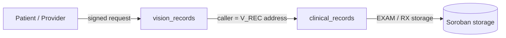
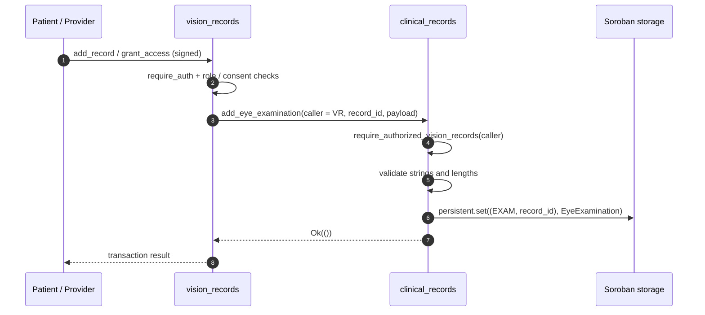
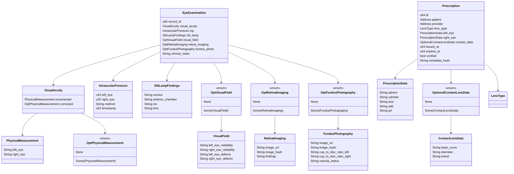
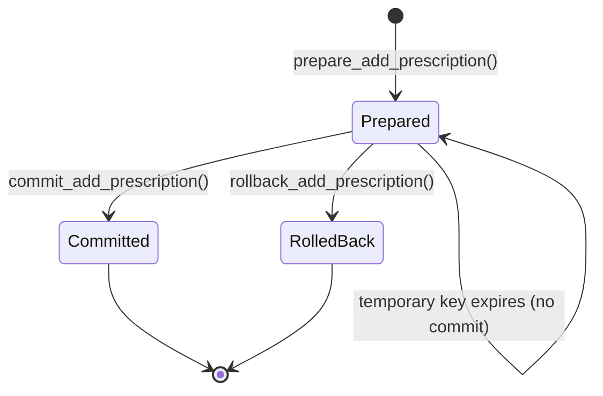

# Clinical Records Contract API Reference

> **Source:** `contracts/clinical_records/src/`
> **Modules:** `lib.rs`, `admin.rs`, `examination.rs`, `prescription.rs`, `types.rs`, `errors.rs`
> **Contract type:** Soroban micro-contract (`ClinicalRecordsContract`)
> **Version:** workspace `1.2.2`

## Overview

`clinical_records` stores structured ophthalmology and optometry data on-chain:

- **Eye examinations** — visual acuity, intraocular pressure (IOP), slit-lamp findings, visual fields, retinal imaging references, fundus photography references, and clinical notes.
- **Prescriptions** — a two-phase prepare/commit/rollback workflow for prescription creation.

The contract is intentionally **not** called directly by patients or clinicians. Every clinical data function requires `caller` to equal the configured `vision_records` contract address. Authorization of patients, providers, and roles is handled by the `vision_records` contract before it invokes this contract.



### Responsibilities

| Concern | Owner |
| --- | --- |
| Patient/provider authentication and role checks | `vision_records` and `access_control` |
| Record ownership, consent, access grants | `vision_records` |
| Clinical examination payload validation and storage | `clinical_records` |
| Two-phase prescription creation | `clinical_records` |
| FHIR v4 / EMR interoperability | `fhir` and `emr_bridge` |

### Contract modules

| Module | Responsibility |
| --- | --- |
| `admin.rs` | Initialization, admin lookup, vision-records address configuration, caller gate |
| `examination.rs` | Examination validation and persistent storage |
| `prescription.rs` | Prepared prescription storage, commit/rollback, counter, reads |
| `types.rs` | Clinical data structures and optional wrappers |
| `errors.rs` | Contract error codes |
| `lib.rs` | On-chain entry points |

---

## Public API Summary

All `env` parameters are supplied by the Soroban runtime and are omitted from client calls. Unless noted otherwise, `caller` must be the configured `V_REC` address.

| Function | Domain | Caller gate | Returns |
| --- | --- | --- | --- |
| [`initialize`](#initialize) | Admin | `admin.require_auth()` | `Result<(), ContractError>` |
| [`get_admin`](#get_admin) | Admin | None | `Result<Address, ContractError>` |
| [`set_vision_records_contract`](#set_vision_records_contract) | Admin | Admin | `Result<(), ContractError>` |
| [`get_vision_records_contract`](#get_vision_records_contract) | Admin | None | `Option<Address>` |
| [`add_eye_examination`](#add_eye_examination) | Examination | `V_REC` only | `Result<(), ContractError>` |
| [`get_eye_examination`](#get_eye_examination) | Examination | `V_REC` only | `Result<EyeExamination, ContractError>` |
| [`prepare_add_prescription`](#prepare_add_prescription) | Prescription | `V_REC` only | `Result<u64, ContractError>` |
| [`commit_add_prescription`](#commit_add_prescription) | Prescription | `V_REC` only | `Result<(), ContractError>` |
| [`rollback_add_prescription`](#rollback_add_prescription) | Prescription | `V_REC` only | `Result<(), ContractError>` |
| [`get_prescription_count`](#get_prescription_count) | Prescription | None | `u64` |
| [`get_prescription`](#get_prescription) | Prescription | `V_REC` only | `Result<Prescription, ContractError>` |

> `get_prescription_count` is the only clinical read that does not require the `V_REC` caller. It only exposes the monotonically increasing counter.

---

## Relationship to `vision_records`

`vision_records` is the only address allowed to call the examination and prescription functions.

### Configuration

1. The clinical contract is deployed and `initialize(admin, vision_records)` stores both addresses.
2. The admin may later call `set_vision_records_contract(admin, new_vision_records)`.
3. The configured address is checked on every gated call by reading `V_REC` from instance storage.
4. If `V_REC` is absent, gated calls fail with `NotInitialized`; if the caller differs, they fail with `Unauthorized`.

### Typical call sequence



### Integration notes

- `record_id` is a `vision_records` record identifier. `clinical_records` does **not** verify that the record exists or that it belongs to the patient/provider in the payload.
- The configured `V_REC` address can write any `record_id`, including one it has never created.
- Direct end-user calls to clinical functions will fail because the caller address is not the contract address.
- If the `vision_records` address changes, data written under the old address remains readable only through the new configured caller. Plan migrations accordingly.
- `fhir` and `emr_bridge` can consume stored structures for interoperability, but they also need an authorized read path (or an off-chain indexer) because `get_eye_examination` and `get_prescription` are `V_REC`-gated.

---

## Data Types

All types are declared with `#[contracttype]` and are Soroban-compatible. Strings are UTF-8 `soroban_sdk::String` values; on-chain length limits are enforced as documented below.

### `PhysicalMeasurement`

| Field | Type | Description |
| --- | --- | --- |
| `left_eye` | `String` | Left-eye measurement/notation. |
| `right_eye` | `String` | Right-eye measurement/notation. |

### `OptPhysicalMeasurement`

| Variant | Payload | Description |
| --- | --- | --- |
| `None` | — | Corrected acuity not supplied. |
| `Some` | `PhysicalMeasurement` | Corrected acuity values. |

### `VisualAcuity`

| Field | Type | Description |
| --- | --- | --- |
| `uncorrected` | `PhysicalMeasurement` | Uncorrected visual acuity for each eye. |
| `corrected` | `OptPhysicalMeasurement` | Corrected visual acuity, optional. |

### `IntraocularPressure`

| Field | Type | Description |
| --- | --- | --- |
| `left_eye` | `u32` | Left-eye IOP value. Units are agreed by integrators (typically mmHg). |
| `right_eye` | `u32` | Right-eye IOP value. |
| `method` | `String` | Measurement method, for example `Goldmann` or `Tonopen`. |
| `timestamp` | `u64` | Unix timestamp in seconds supplied by the caller; not validated against ledger time. |

### `SlitLampFindings`

| Field | Type | Description |
| --- | --- | --- |
| `cornea` | `String` | Cornea findings. |
| `anterior_chamber` | `String` | Anterior chamber findings. |
| `iris` | `String` | Iris findings. |
| `lens` | `String` | Lens findings. |

### `VisualField`

| Field | Type | Description |
| --- | --- | --- |
| `left_eye_reliability` | `String` | Left-eye reliability indices. May be empty (min length 0). |
| `right_eye_reliability` | `String` | Right-eye reliability indices. May be empty. |
| `left_eye_defects` | `String` | Left-eye defect description. May be empty. |
| `right_eye_defects` | `String` | Right-eye defect description. May be empty. |

### `OptVisualField`

| Variant | Payload | Description |
| --- | --- | --- |
| `None` | — | Visual field not performed. |
| `Some` | `VisualField` | Visual field results. |

### `RetinalImaging`

| Field | Type | Description |
| --- | --- | --- |
| `image_url` | `String` | Off-chain or IPFS URL for the retinal image. |
| `image_hash` | `String` | Content hash for integrity verification. |
| `findings` | `String` | Radiologist/ophthalmologist interpretation. May be empty. |

### `OptRetinalImaging`

| Variant | Payload | Description |
| --- | --- | --- |
| `None` | — | Retinal imaging not performed. |
| `Some` | `RetinalImaging` | Retinal imaging record. |

### `FundusPhotography`

| Field | Type | Description |
| --- | --- | --- |
| `image_url` | `String` | Fundus image URL. |
| `image_hash` | `String` | Content hash. |
| `cup_to_disc_ratio_left` | `String` | Left-eye cup-to-disc ratio, stored as text. |
| `cup_to_disc_ratio_right` | `String` | Right-eye cup-to-disc ratio. |
| `macula_status` | `String` | Macula assessment. May be empty. |

### `OptFundusPhotography`

| Variant | Payload | Description |
| --- | --- | --- |
| `None` | — | Fundus photography not performed. |
| `Some` | `FundusPhotography` | Fundus photography record. |

### `EyeExamination`

Stored at `("EXAM", record_id)`.

| Field | Type | Description |
| --- | --- | --- |
| `record_id` | `u64` | Vision record identifier supplied by `vision_records`. |
| `visual_acuity` | `VisualAcuity` | Uncorrected and optional corrected acuity. |
| `iop` | `IntraocularPressure` | Pressure measurements plus method and timestamp. |
| `slit_lamp` | `SlitLampFindings` | Anterior segment findings. |
| `visual_field` | `OptVisualField` | Optional visual field. |
| `retina_imaging` | `OptRetinalImaging` | Optional retinal imaging reference. |
| `fundus_photo` | `OptFundusPhotography` | Optional fundus photography reference. |
| `clinical_notes` | `String` | Free-text notes, 0–2048 bytes. |

### `LensType`

| Variant | Description |
| --- | --- |
| `Glasses` | Glasses prescription. |
| `ContactLens` | Contact-lens prescription. |

### `PrescriptionData`

| Field | Type | Description |
| --- | --- | --- |
| `sphere` | `String` | Spherical power. Required, 1–64 bytes. |
| `cylinder` | `String` | Cylindrical power. Required, 1–64 bytes. |
| `axis` | `String` | Axis. Required, 1–32 bytes. |
| `add` | `String` | Add power. Required, 1–32 bytes. |
| `pd` | `String` | Pupillary distance. Required, 1–32 bytes. |

### `ContactLensData`

| Field | Type | Description |
| --- | --- | --- |
| `base_curve` | `String` | Contact-lens base curve. |
| `diameter` | `String` | Contact-lens diameter. |
| `brand` | `String` | Lens brand. |

### `OptionalContactLensData`

| Variant | Payload | Description |
| --- | --- | --- |
| `None` | — | No contact-lens details. |
| `Some` | `ContactLensData` | Contact-lens details. |

### `Prescription`

Stored at `("RX", id)`.

| Field | Type | Description |
| --- | --- | --- |
| `id` | `u64` | Prescription identifier assigned by the prepare phase. |
| `patient` | `Address` | Patient address supplied by `vision_records`. |
| `provider` | `Address` | Prescriber address supplied by `vision_records`. |
| `lens_type` | `LensType` | Always `Glasses` when created through the current two-phase API. |
| `left_eye` | `PrescriptionData` | Left-eye values. |
| `right_eye` | `PrescriptionData` | Right-eye values (currently a copy of the prepared data). |
| `contact_data` | `OptionalContactLensData` | Always `None` through the current API. |
| `issued_at` | `u64` | Ledger timestamp captured during `prepare_add_prescription`. |
| `expires_at` | `u64` | `issued_at + 31,536,000` seconds (365 days). |
| `verified` | `bool` | Always `false` when created through the current API. |
| `metadata_hash` | `String` | Always empty when created through the current API. |

### Data model



---

## Validation Rules

Validation is performed on every write. Failure returns `ContractError::InvalidInput`.

| Field | Min length | Max length | Notes |
| --- | ---: | ---: | --- |
| `visual_acuity.uncorrected.left_eye` | 1 | 64 | Required |
| `visual_acuity.uncorrected.right_eye` | 1 | 64 | Required |
| Corrected acuity values (when `Some`) | 1 | 64 | Required for each eye |
| `iop.method` | 1 | 64 | Required |
| `slit_lamp.cornea` | 1 | 256 | Required |
| `slit_lamp.anterior_chamber` | 1 | 256 | Required |
| `slit_lamp.iris` | 1 | 256 | Required |
| `slit_lamp.lens` | 1 | 256 | Required |
| `visual_field.*_reliability` | 0 | 128 | Optional text when `Some` |
| `visual_field.*_defects` | 0 | 256 | Optional text when `Some` |
| `retina_imaging.image_url` | 1 | 256 | Required when `Some` |
| `retina_imaging.image_hash` | 1 | 128 | Required when `Some` |
| `retina_imaging.findings` | 0 | 512 | Optional text when `Some` |
| `fundus_photo.image_url` | 1 | 256 | Required when `Some` |
| `fundus_photo.image_hash` | 1 | 128 | Required when `Some` |
| `fundus_photo.cup_to_disc_ratio_left` | 1 | 64 | Required when `Some` |
| `fundus_photo.cup_to_disc_ratio_right` | 1 | 64 | Required when `Some` |
| `fundus_photo.macula_status` | 0 | 256 | Optional text when `Some` |
| `clinical_notes` | 0 | 2048 | Optional |
| `prescription_data.sphere` | 1 | 64 | Required |
| `prescription_data.cylinder` | 1 | 64 | Required |
| `prescription_data.axis` | 1 | 32 | Required |
| `prescription_data.add` | 1 | 32 | Required |
| `prescription_data.pd` | 1 | 32 | Required |

**Not validated**

- IOP values (`u32`) have no clinical range check.
- `iop.timestamp` is not compared with `env.ledger().timestamp()`.
- `record_id` is not checked against `vision_records`.
- `patient` and `provider` are not checked for distinctness or authorization.
- `metadata_hash` is not supplied by the prepare call and is always empty.

String lengths are measured in bytes by `soroban_sdk::String::len()`.

---

## Admin Functions

### `initialize`

```rust
pub fn initialize(
    env: Env,
    admin: Address,
    vision_records: Address,
) -> Result<(), ContractError>
```

Initializes the contract and configures the only address allowed to write clinical data.

**Parameters**

| Name | Type | Description |
| --- | --- | --- |
| `admin` | `Address` | Administrator; must authorize. |
| `vision_records` | `Address` | Vision Records contract address allowed to call clinical functions. |

**Returns:** `Result<(), ContractError>`

**Errors**

- `AlreadyInitialized` — `INIT` already exists.
- Any auth failure propagated by `admin.require_auth()`.

**Storage:** writes `ADMIN`, `V_REC`, and `INIT` to instance storage.

---

### `get_admin`

```rust
pub fn get_admin(env: Env) -> Result<Address, ContractError>
```

Returns the administrator.

**Returns:** `Result<Address, ContractError>`

**Errors:** `NotInitialized` when `ADMIN` is absent.

---

### `set_vision_records_contract`

```rust
pub fn set_vision_records_contract(
    env: Env,
    admin: Address,
    vision_records: Address,
) -> Result<(), ContractError>
```

Changes the authorized Vision Records contract address.

**Parameters**

| Name | Type | Description |
| --- | --- | --- |
| `admin` | `Address` | Must authorize and match the stored admin. |
| `vision_records` | `Address` | New authorized caller. |

**Returns:** `Result<(), ContractError>`

**Errors**

- `NotInitialized` — contract has no admin.
- `Unauthorized` — supplied admin does not match the stored admin.

**Storage:** updates `V_REC` (instance).

---

### `get_vision_records_contract`

```rust
pub fn get_vision_records_contract(env: Env) -> Option<Address>
```

Returns the configured Vision Records address, or `None` before initialization.

**Returns:** `Option<Address>`

---

## Examination Functions

### `add_eye_examination`

```rust
pub fn add_eye_examination(
    env: Env,
    caller: Address,
    record_id: u64,
    visual_acuity: VisualAcuity,
    iop: IntraocularPressure,
    slit_lamp: SlitLampFindings,
    visual_field: OptVisualField,
    retina_imaging: OptRetinalImaging,
    fundus_photo: OptFundusPhotography,
    clinical_notes: String,
) -> Result<(), ContractError>
```

Validates and stores a complete eye examination. Existing data for the same `record_id` is overwritten.

**Parameters**

| Name | Type | Description |
| --- | --- | --- |
| `caller` | `Address` | Must equal the configured `V_REC` address. |
| `record_id` | `u64` | Vision record identifier. |
| `visual_acuity` | `VisualAcuity` | Required acuity data. |
| `iop` | `IntraocularPressure` | Required pressure data. |
| `slit_lamp` | `SlitLampFindings` | Required anterior-segment findings. |
| `visual_field` | `OptVisualField` | Optional visual field. |
| `retina_imaging` | `OptRetinalImaging` | Optional retinal imaging. |
| `fundus_photo` | `OptFundusPhotography` | Optional fundus photography. |
| `clinical_notes` | `String` | Free-text notes, 0–2048 bytes. |

**Returns:** `Result<(), ContractError>`

**Errors**

- `NotInitialized` — `V_REC` is not configured.
- `Unauthorized` — `caller` is not `V_REC`.
- `InvalidInput` — any string length rule fails.

**Storage:** writes `("EXAM", record_id)` (persistent) as `EyeExamination`.

> The function uses `set`, so calling it twice with the same `record_id` replaces the previous examination. There is no immutable history or versioning in this contract.

---

### `get_eye_examination`

```rust
pub fn get_eye_examination(
    env: Env,
    caller: Address,
    record_id: u64,
) -> Result<EyeExamination, ContractError>
```

Reads a stored examination.

**Parameters**

| Name | Type | Description |
| --- | --- | --- |
| `caller` | `Address` | Must equal the configured `V_REC` address. |
| `record_id` | `u64` | Examination key. |

**Returns:** `Result<EyeExamination, ContractError>`

**Errors**

- `NotInitialized` — `V_REC` is not configured.
- `Unauthorized` — `caller` is not `V_REC`.
- `RecordNotFound` — no examination at `record_id`.

---

## Prescription Functions (Two-Phase Commit)

Prescription creation uses a prepare → commit/rollback protocol. This separates validation and identifier allocation from the final durable write.

### Lifecycle

```mermaid
sequenceDiagram
  autonumber
  participant VR as vision_records
  participant CR as clinical_records
  participant T as Temporary storage
  participant P as Persistent storage

  VR->>CR: prepare_add_prescription(caller, patient, provider, data)
  CR->>CR: require_authorized_vision_records(caller)
  CR->>CR: validate_prescription_data(data)
  CR->>CR: next_id = RX_CTR + 1
  CR->>CR: RX_CTR = next_id
  CR->>T: set((P_ADD_RX, next_id), (patient, provider, data, now))
  CR-->>VR: Ok(next_id)

  alt commit
    VR->>CR: commit_add_prescription(caller, rx_id)
    CR->>CR: require_authorized_vision_records(caller)
    CR->>T: get((P_ADD_RX, rx_id))
    T-->>CR: prepared tuple / None
    alt prepared exists
      CR->>CR: build Prescription with defaults
      CR->>P: set((RX, rx_id), prescription)
      CR->>T: remove((P_ADD_RX, rx_id))
      CR-->>VR: Ok(())
    else missing or already committed
      CR-->>VR: Err(InvalidPhase)
    end
  else rollback
    VR->>CR: rollback_add_prescription(caller, rx_id)
    CR->>CR: require_authorized_vision_records(caller)
    CR->>T: remove((P_ADD_RX, rx_id))
    CR-->>VR: Ok(())
  end
```





### Commit defaults and limitations

`commit_add_prescription` builds the final `Prescription` from the prepared tuple and applies these fixed values:

| Field | Value |
| --- | --- |
| `lens_type` | `LensType::Glasses` |
| `left_eye` | Prepared `PrescriptionData` |
| `right_eye` | Same prepared `PrescriptionData` (both eyes receive identical values) |
| `contact_data` | `OptionalContactLensData::None` |
| `issued_at` | Ledger timestamp captured during prepare |
| `expires_at` | `issued_at + 31_536_000` (365 days) |
| `verified` | `false` |
| `metadata_hash` | Empty string |

Consequences:

- There is no API to create a contact-lens prescription or separate left/right values through this flow.
- There is no verification/signature step for the prescription.
- The 365-day expiry is fixed and not caller-configurable.
- `metadata_hash` cannot be supplied, so external metadata commitments are not supported by this version.

### Identifier and rollback behavior

- `RX_CTR` is incremented during **prepare**, before commit succeeds.
- A rollback does **not** decrement `RX_CTR`; identifier gaps are expected.
- `rollback_add_prescription` returns `Ok(())` even when the prepared key does not exist.
- `commit_add_prescription` returns `InvalidPhase` when the prepared key is missing (unknown id or already committed/rolled back).
- Temporary storage entries are not explicitly extended; they follow Soroban temporary-entry TTL behavior. A prepared prescription that expires before commit cannot be committed.

---

### `prepare_add_prescription`

```rust
pub fn prepare_add_prescription(
    env: Env,
    caller: Address,
    patient: Address,
    provider: Address,
    prescription_data: PrescriptionData,
) -> Result<u64, ContractError>
```

Validates prescription data, allocates the next identifier, and stores a temporary prepared entry.

**Parameters**

| Name | Type | Description |
| --- | --- | --- |
| `caller` | `Address` | Must equal the configured `V_REC` address. |
| `patient` | `Address` | Patient address; stored as supplied. |
| `provider` | `Address` | Prescriber address; stored as supplied. |
| `prescription_data` | `PrescriptionData` | Sphere, cylinder, axis, add, and PD. |

**Returns:** `Result<u64, ContractError>` — the prepared prescription id.

**Errors**

- `NotInitialized` — `V_REC` is not configured.
- `Unauthorized` — `caller` is not `V_REC`.
- `InvalidInput` — a `PrescriptionData` string fails its length rule.

**Storage**

- Reads/writes `RX_CTR` (instance), incrementing with `saturating_add(1)`.
- Writes `("P_ADD_RX", id)` (temporary) containing `(patient, provider, prescription_data, timestamp)`.

---

### `commit_add_prescription`

```rust
pub fn commit_add_prescription(
    env: Env,
    caller: Address,
    rx_id: u64,
) -> Result<(), ContractError>
```

Commits a prepared prescription into persistent storage and removes the temporary entry.

**Parameters**

| Name | Type | Description |
| --- | --- | --- |
| `caller` | `Address` | Must equal the configured `V_REC` address. |
| `rx_id` | `u64` | Identifier returned by `prepare_add_prescription`. |

**Returns:** `Result<(), ContractError>`

**Errors**

- `NotInitialized` — `V_REC` is not configured.
- `Unauthorized` — `caller` is not `V_REC`.
- `InvalidPhase` — no prepared entry exists for `rx_id`.

**Storage**

- Reads/removes `("P_ADD_RX", rx_id)` (temporary).
- Writes `("RX", rx_id)` (persistent) as `Prescription`.

---

### `rollback_add_prescription`

```rust
pub fn rollback_add_prescription(
    env: Env,
    caller: Address,
    rx_id: u64,
) -> Result<(), ContractError>
```

Removes a prepared prescription without committing it.

**Parameters**

| Name | Type | Description |
| --- | --- | --- |
| `caller` | `Address` | Must equal the configured `V_REC` address. |
| `rx_id` | `u64` | Prepared identifier to discard. |

**Returns:** `Result<(), ContractError>`

**Errors**

- `NotInitialized` — `V_REC` is not configured.
- `Unauthorized` — `caller` is not `V_REC`.

**Storage:** removes `("P_ADD_RX", rx_id)` (temporary). Missing keys are ignored.

---

### `get_prescription_count`

```rust
pub fn get_prescription_count(env: Env) -> u64
```

Returns the latest allocated prescription identifier. Because the counter advances on prepare and is not decremented on rollback, this is **not** necessarily the number of committed prescriptions.

**Returns:** `u64` — `0` when no prescription has been prepared.

---

### `get_prescription`

```rust
pub fn get_prescription(
    env: Env,
    caller: Address,
    id: u64,
) -> Result<Prescription, ContractError>
```

Reads a committed prescription.

**Parameters**

| Name | Type | Description |
| --- | --- | --- |
| `caller` | `Address` | Must equal the configured `V_REC` address. |
| `id` | `u64` | Committed prescription identifier. |

**Returns:** `Result<Prescription, ContractError>`

**Errors**

- `NotInitialized` — `V_REC` is not configured.
- `Unauthorized` — `caller` is not `V_REC`.
- `RecordNotFound` — no committed prescription at `id`.

---

## Storage Key Reference

All keys are contract-local. `Symbol` constants use `symbol_short!`.

| Key tuple | Symbol | Tier | Value type | Purpose | Written by |
| --- | --- | --- | --- | --- | --- |
| `ADMIN` | `ADMIN` | Instance | `Address` | Contract administrator | `initialize` |
| `V_REC` | `V_REC` | Instance | `Address` | Authorized Vision Records caller | `initialize`, `set_vision_records_contract` |
| `INIT` | `INIT` | Instance | `bool` | Initialization guard | `initialize` |
| `RX_CTR` | `RX_CTR` | Instance | `u64` | Monotonic prescription id counter | `prepare_add_prescription` |
| `(EXAM, record_id)` | `EXAM` | Persistent | `EyeExamination` | Examination by vision record id | `add_eye_examination` |
| `(RX, id)` | `RX` | Persistent | `Prescription` | Committed prescription | `commit_add_prescription` |
| `(P_ADD_RX, id)` | `P_ADD_RX` | Temporary | `(Address, Address, PrescriptionData, u64)` | Prepared prescription tuple | `prepare_add_prescription`; removed by commit/rollback |

### Storage notes

- `ADMIN`, `V_REC`, `INIT`, and `RX_CTR` live in **instance** storage.
- `EXAM` and `RX` are **persistent** entries.
- `P_ADD_RX` is **temporary** storage and must be committed or rolled back before its TTL expires.
- The contract does not call `extend_ttl` for any key.
- There is no reverse index from patient or provider to record ids. Off-chain indexers must derive that mapping from `vision_records` or transaction events.

---

## Errors

`ContractError` is defined in `errors.rs`.

| Code | Variant | Typical cause |
| ---: | --- | --- |
| 1 | `AlreadyInitialized` | `initialize` called twice. |
| 2 | `NotInitialized` | Missing `ADMIN` or `V_REC`, especially when calling before initialization. |
| 3 | `Unauthorized` | Caller is not the configured `V_REC`; admin mismatch in `set_vision_records_contract`. |
| 4 | `InvalidInput` | A string is empty where required or exceeds its maximum length. |
| 5 | `InvalidRecordType` | Reserved; not returned by the current clinical entry points. |
| 6 | `RecordNotFound` | No examination or committed prescription at the requested id. |
| 7 | `InvalidPhase` | Commit attempted without an active prepared entry. |

Auth failures raised by `Address::require_auth()` are surfaced by the Soroban runtime and are not wrapped in `ContractError`.

---

## Events

`clinical_records` currently emits **no contract events**. Indexers must inspect ledger storage changes or consume events from `vision_records` to detect new examinations and prescriptions.

---

## Security and Privacy Notes

1. **Single-caller gate:** Only `V_REC` can read or write clinical payloads. This is a contract-address check, not a user-role check.
2. **No record ownership check:** The contract trusts `vision_records` to enforce patient/provider ownership and consent. A compromised or upgraded `V_REC` address can read and overwrite any clinical data.
3. **Overwrite semantics:** `add_eye_examination` replaces existing data for the same `record_id`; there is no on-chain history.
4. **Off-chain content:** Imaging records store URLs and hashes, not image bytes. Integrity depends on verifying `image_hash` off-chain.
5. **No encryption enforcement:** Strings are stored as supplied. Encryption and access control must happen before submission.
6. **No clinical range validation:** IOP and other numeric values are stored without physiological bounds checks.
7. **Fixed prescription defaults:** Both eyes share one prescription value set, lens type is always glasses, and prescriptions are never marked verified by this API.
8. **Counter gaps:** Do not use `get_prescription_count()` as a count of existing prescriptions.
9. **Prepared-data TTL:** A prepared prescription is temporary. Off-chain coordinators should commit or roll back promptly.
10. **Admin key:** The admin can repoint `V_REC`. Protect the admin key with the same care as the vision records contract.

---

## Related Documentation

- [Vision Records Architecture](../vision-records-architecture.md)
- [Access Control API](access_control.md)
- [FHIR API](fhir.md)
- [EMR Bridge API](emr_bridge.md)
- [Storage Key Conventions](../storage-key-conventions.md)
- [Clinical Records Source](../../contracts/clinical_records/src/lib.rs)
