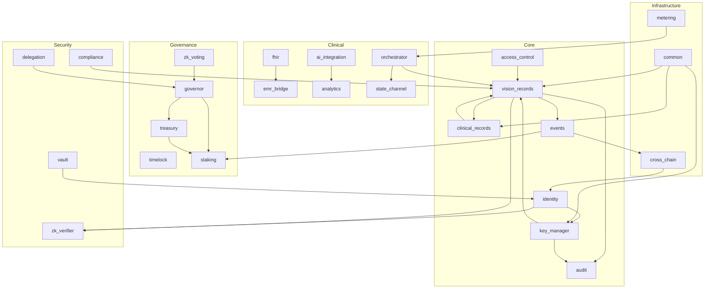

# Cross-Contract Interactions

This document summarizes the key runtime dependencies across the RetinaX contract system. It complements the deployment guide and clarifies how the 24+ contract modules relate to one another.

## 1. Dependency groups

### Core
- `vision_records`
- `access_control`
- `clinical_records`
- `identity`
- `key_manager`
- `events`
- `audit`

### Clinical
- `fhir`
- `emr_bridge`
- `analytics`
- `ai_integration`
- `state_channel`
- `orchestrator`

### Governance
- `governor`
- `timelock`
- `treasury`
- `staking`
- `zk_voting`

### Security
- `zk_verifier`
- `compliance`
- `delegation`
- `vault`

### Infrastructure
- `common`
- `metering`
- `cross_chain`
- `orchestrator`
- `event`/logging integrations

## 2. Contract dependency graph

## 3. Call relationships and responsibilities

### Core contract relationships

- `vision_records` is the primary medical record contract and the center of the patient-record graph.
- `access_control` provides a standalone RBAC provider that `vision_records` can consult via `set_access_control()` and `get_access_control()`.
- `clinical_records` is tied to `vision_records` through `initialize(admin, vision_records)` and `set_vision_records_contract(...)`.
- `key_manager` and `identity` support secure key derivation, ownership, and recovery flows for the record layer.
- `events` and `audit` provide immutable event and audit trails for record and policy activity.

### Clinical relationships

- `fhir` and `emr_bridge` convert and normalize clinical data.
- `analytics` consumes usage and health signals from related clinical modules.
- `ai_integration` consumes clinical signal inputs and can rotate provider logic based on result quality or SLA thresholds.
- `state_channel` and `orchestrator` coordinate multi-step workflows and cross-participant coordination.

### Governance and security relationships

- `staking`, `treasury`, and `governor` form the governance and financial control plane.
- `timelock` inserts execution delays and proposal checkpoints around governance actions.
- `zk_verifier` and `zk_voting` provide verification and governance proofs.
- `compliance` and `delegation` enforce policy and delegated authority rules.

## 4. Circular dependencies

There are no direct circular runtime dependency loops where contract A deploys contract B and B immediately calls A back during initialization. In practical terms, the graph is mostly acyclic.

A few indirect loops exist at the governance and orchestration layer, especially:

- `governor -> treasury` and `treasury -> governor` via governance-enforced treasury actions
- `vision_records -> clinical_records` and `clinical_records -> vision_records` through configured contract references

These are configuration references rather than hard boot-time recursion; they are intentional registry links, not a storage or deployment deadlock.

## 5. Domain summary

| Domain | Primary contracts | Main dependency theme |
|---|---|---|
| Core | `vision_records`, `access_control`, `clinical_records`, `identity`, `key_manager` | Record ownership, access enforcement, identity |
| Clinical | `fhir`, `emr_bridge`, `analytics`, `ai_integration`, `state_channel` | Clinical workflows and data normalization |
| Governance | `governor`, `timelock`, `treasury`, `staking`, `zk_voting` | Decisions, quorum, treasury controls |
| Security | `zk_verifier`, `compliance`, `delegation`, `vault` | Authentication, compliance, policy enforcement |
| Infrastructure | `common`, `metering`, `cross_chain`, `orchestrator` | Shared utilities, connection services, runtime coordination |

## 6. Operational guidance

For deployments, treat the system as a layered dependency stack:

1. Deploy the base security and key layers.
2. Deploy `access_control` and `vision_records`.
3. Wire `vision_records` to `access_control` and `clinical_records`.
4. Deploy clinical workflow and governance layers.
5. Only then run full integration checks and testnet verification.

This avoids invalid references during initialization and keeps contract bootstrapping predictable.
